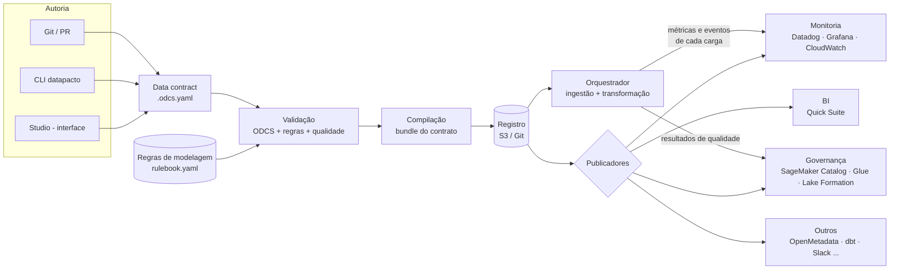

# Visão — plataforma open source de data contracts

> Status: proposta para discussão. Nome do projeto: **datapacto** (decidido, seção 16).

## 1. Em uma frase

**Um data contract entra; a pipeline, a qualidade, a monitoria e o catálogo saem prontos.**

A pessoa descreve a tabela uma vez (o contrato). A plataforma valida o contrato contra as **regras de modelagem da
empresa**, gera o que é preciso para o dado chegar ao lake (ingestão e transformação) e publica o mesmo contrato em
todos os lugares que hoje são preenchidos à mão: ferramentas de monitoria, catálogo de dados, BI e assim por diante.

## 2. As dores que queremos resolver

| Dor | Como aparece no dia a dia |
|---|---|
| Pipeline nova é artesanal | Cada tabela vira um projeto copiado de outro, com ajustes manuais e erros de copiar e colar. |
| Qualidade descoberta tarde | O dado quebrado é visto pelo consumidor (no dashboard), não pela pipeline. |
| Catálogo desatualizado | Descrição, dono e classificação são preenchidos depois, quando são. |
| Monitoria inconsistente | Cada time cria alarmes do seu jeito; tabelas novas ficam sem alerta. |
| Padrão de modelagem só no PDF | As regras de nomenclatura e tipagem existem num documento que ninguém consegue checar automaticamente. |
| Mesma informação em 5 lugares | Nome, tipo, dono e SLA de uma tabela são digitados no código, no catálogo, no BI e na monitoria. |

## 3. Referência: o que o datacontract.com faz, e onde nos diferenciamos

O ecossistema do [datacontract.com](https://datacontract.com) (mantido pela Entropy Data) é a melhor referência
pública do tema. Pelo que é público hoje, ele oferece:

- **Data Contract CLI**: `lint`, `test` (roda as regras de qualidade contra o dado), `import` e `export` para muitos
  formatos (SQL, dbt, Avro, JSON Schema, Great Expectations, Glue...), detecção de mudanças que quebram compatibilidade e changelog;
- **Data Contract Editor**: edição visual do contrato (ODCS);
- **Entropy Data**: catálogo/marketplace de data products e contratos (produto comercial).

| Tema | datacontract.com | Este projeto |
|---|---|---|
| Padrão do contrato | ODCS | **ODCS** (mesmo padrão: compatível com o CLI e o Editor deles) |
| Validar e testar o contrato | Sim | Sim, e **contra as regras de modelagem da empresa** (enviadas em PDF/XLS) |
| Gerar a pipeline | Exporta artefatos (ex: dbt) | **Gera a pipeline completa**: ingestão (`ingestion.yml` + orquestrador) e transformação (PySpark ou Scala) |
| Nomenclatura das colunas | Não | **Propõe e valida** os nomes padronizados (heurística ou LLM) |
| Publicar em monitoria e catálogo | Catálogo próprio (Entropy Data) | **Publica nas ferramentas que a empresa já usa**: Datadog, Grafana, CloudWatch, SageMaker Catalog, Glue, Quick Suite... |
| Execução | Fora do escopo | **Orquestrador próprio**, que emite métricas padronizadas de cada carga |
| Foco de nuvem | Agnóstico | **AWS primeiro** (S3, Glue, EMR, Lake Formation), sem fechar a porta para outras |

A ideia não é competir com o CLI deles: o contrato continua ODCS puro, e quem quiser pode usar o `datacontract lint`
e o Editor deles nos mesmos arquivos. O que acrescentamos é a **automação do caminho inteiro**, do contrato até a
pipeline rodando e monitorada.

## 4. Princípios

1. **O contrato é a única fonte da verdade.** Nada é digitado duas vezes. Se está no catálogo, veio do contrato.
2. **O contrato diz O QUÊ; a configuração da plataforma diz ONDE.** O contrato não sabe que existe Datadog: quem
   decide para onde publicar é o `platform.yaml` de cada ambiente.
3. **Padrões abertos.** ODCS no contrato, YAML versionado, plugins em Python, Terraform/APIs oficiais nos destinos.
4. **Tudo tem `plan` antes de `apply`.** Toda publicação mostra o que vai mudar (como o `terraform plan`) antes de mudar.
5. **Idempotente.** Publicar o mesmo contrato duas vezes não duplica nada.
6. **Sem segredo no contrato.** Só referências (ARN de secret, nome de role).
7. **Humano no controle.** O LLM sugere (nomes, regras extraídas do PDF); uma pessoa revisa e aprova.
8. **Plugável.** Cada destino (Datadog, Grafana, SageMaker...) é um plugin; a comunidade adiciona os seus.

## 5. Arquitetura



O fluxo tem dois momentos:

- **Em tempo de publicação** (quando o contrato é aprovado): os publicadores criam ou atualizam monitores,
  dashboards, entradas de catálogo e datasets de BI a partir do contrato.
- **Em tempo de execução** (a cada carga): o orquestrador emite métricas e resultados de qualidade com nomes
  padronizados, e os monitores criados na publicação passam a acompanhar esses números.

### Camadas

| Camada | Responsabilidade | Hoje |
|---|---|---|
| Autoria | Criar e editar o contrato | **Existe**: Studio (`datapacto ui`) e CLI (`datapacto contrato`, `generate`) |
| Regras de modelagem | Transformar o documento de padrões da empresa em regras checáveis | Parcial: nomenclatura, glossário e tipagem estão **no código** (`standards/`, `skills/`) |
| Validação | ODCS, regras de modelagem, consistência | Parcial: ODCS + nomenclatura + checklist do Studio |
| Compilação | Gerar o *bundle* (todos os artefatos do contrato) | Parcial: gera `ingestion.yml` e a transformação |
| Registro | Guardar contratos e bundles versionados | Parcial: `--publish-s3` envia só o `ingestion.yml` |
| Publicadores | Levar o contrato para cada ferramenta | **Novo** |
| Execução | Rodar a carga | **Existe**: `datapacto-orchestrator` (JDBC → raw) e o projeto de transformação gerado |
| Telemetria | Métricas e eventos padronizados de cada carga | Parcial: o orquestrador loga, mas não publica métricas |

## 6. Conceitos

| Conceito | O que é |
|---|---|
| **Data contract** | Arquivo ODCS (`.odcs.yaml`) de um data product: tabelas, colunas, dono, SLA, qualidade, classificação. |
| **Regras de modelagem** (*rulebook*) | Versão checável do padrão da empresa: nomenclatura, tipos permitidos, campos obrigatórios, classificação, convenções de partição. Nasce de PDF/XLS enviados pela pessoa. |
| **Bundle** | Tudo que a compilação gera para um contrato numa versão: `ingestion.yml`, projeto de transformação, regras de qualidade, metadados de catálogo, definições de monitores. |
| **Registro** | Onde contratos e bundles ficam versionados (S3 e/ou Git). É o que os publicadores e o orquestrador leem. |
| **Publicador** (*publisher*) | Plugin que leva o contrato a um destino (Datadog, SageMaker Catalog...). Implementa `plan` e `apply`. |
| **platform.yaml** | Configuração por ambiente: quais publicadores estão ligados, contas, regiões, credenciais (por referência). |
| **Evento de carga** | Registro padronizado de cada execução (linhas lidas, duração, partição, resultado de cada regra de qualidade). |

## 7. Regras de modelagem — o ambiente na interface

Hoje o padrão de nomenclatura é um texto embutido no código, a tipagem é uma tabela fixa e o glossário é uma lista
em Python. A proposta é transformar isso num **ambiente próprio**, em que cada empresa envia os seus documentos.

### Fluxo

```
PDF / XLSX / DOCX / MD  ──▶  extração  ──▶  rascunho do rulebook  ──▶  revisão humana  ──▶  rulebook ativo (versão N)
   (upload na UI)          (texto + LLM)      (regras propostas)       (aceitar/editar)       (usado na validação)
```

1. **Upload**: a pessoa envia um ou mais documentos na tela *Regras de modelagem* (ou coloca os arquivos na pasta
   `rules/fontes/`).
2. **Extração**: texto e tabelas são extraídos (PDF e DOCX por texto, XLSX por planilha). Para cada tipo de regra
   conhecido, o LLM propõe a regra estruturada **citando o trecho de origem** (página/linha), para a revisão ser rápida.
3. **Revisão**: a tela mostra cada regra proposta ao lado do trecho do documento. A pessoa aceita, edita ou descarta.
4. **Ativação**: o rulebook aprovado ganha uma versão. A partir daí, toda validação de contrato usa essa versão, e o
   contrato registra contra qual versão foi validado.

Sem LLM configurado, o rulebook pode ser escrito direto em YAML (ou começar de um modelo pronto).

### Formato proposto (`rules/rulebook.yaml`)

```yaml
version: 3
fonte: [padroes-modelagem.pdf, tipagem.xlsx]
nomenclatura:
  formato: "^[a-z]{2}(_[a-z0-9]+)+$"        # natureza + termos, minúsculo, sem acento
  naturezas:                                # prefixo → tipos aceitos
    cd: [IntegerType, LongType, StringType]
    dt: [DateType]
    vl: [DecimalType]
  max_termos: 6
  reservados: [dh_criacao_data_lake]        # colunas de controle da plataforma
  glossario: glossario.xlsx                 # termo em inglês → termo padrão
tipagem:                                    # tipo de origem → tipo final
  varchar: StringType
  numeric: DecimalType
obrigatorio:
  contrato: [team, description.purpose, slaProperties.frequency]
  coluna: [description]
classificacao:
  niveis: [public, internal, restricted, confidential]
  criptografar_se: restricted               # coluna restricted exige encrypt
particao:
  raw: { coluna: dt_ingestao, formato: yyyyMMdd }
severidade_padrao: error                    # regra quebrada bloqueia a publicação
```

O que já existe migra para cá: `standards/nomenclatura.py` (regras e naturezas), `standards/tipagem.py` (tabela de
tipos), `standards/glossary.py` (glossário) e o texto do padrão usado no prompt do LLM. O código passa a **ler o
rulebook** em vez de ter as regras fixas, e o projeto traz um rulebook de exemplo.

## 8. O bundle do contrato

A compilação gera um bundle por contrato e versão:

```
registry/
└── vendas/cliente/1.2.0/
    ├── contract.odcs.yaml          # o contrato aprovado
    ├── validation.json             # resultado da validação (e versão do rulebook usada)
    ├── ingestion.yml               # para o orquestrador
    ├── transformation/             # projeto PySpark ou Scala gerado
    ├── quality.yml                 # regras de qualidade normalizadas (para qualquer motor)
    ├── catalog.json                # metadados neutros: descrições, dono, classificação, glossário
    └── monitors.yml                # monitores neutros: freshness, volume, qualidade, falha da carga
```

`catalog.json` e `monitors.yml` são **neutros**: descrevem o que monitorar e catalogar sem citar nenhuma ferramenta.
Cada publicador traduz esses arquivos para a sua ferramenta. Assim, adicionar um destino novo não muda o compilador.

## 9. Estratégia de destinos: visão própria, depois AWS, depois multi-cloud

A plataforma não depende de nenhuma ferramenta externa para ter valor. A ordem é:

| Etapa | O que é | Por quê |
|---|---|---|
| **1. Visão própria** | Catálogo e painel de saúde **dentro do Studio**, lendo o registro de contratos e os eventos de carga | Funciona no primeiro dia, sem conta em ferramenta nenhuma; é a demonstração do projeto |
| **2. AWS** | Publicadores nativos: CloudWatch (monitoria) e Glue Data Catalog (catálogo), depois Lake Formation e SageMaker Catalog | É onde a pipeline gerada já roda (S3, Glue, EMR) |
| **3. Ferramentas de mercado** | Datadog, Grafana, Quick Suite, OpenMetadata... | Para empresas que já usam essas ferramentas |
| **4. Multi-cloud** | Runtime e publicadores para GCP (BigQuery, Dataplex, Cloud Monitoring) e Azure (Fabric/Synapse, Purview, Azure Monitor) | Amplia o público quando a base estiver madura |

### Visão própria

O que o Studio mostra sem integração externa:

- **Catálogo**: busca por contrato, tabela, coluna, dono, domínio e classificação; página de cada data product com
  descrição, colunas (nome na origem e na staging), SLA, regras de qualidade e versões.
- **Saúde**: para cada contrato, as últimas cargas (status, linhas, duração), o resultado de cada regra de qualidade
  e o atraso em relação ao SLA (freshness), lidos dos eventos de carga gravados no registro (seção 11).
- **Mudanças**: histórico de versões do contrato, com as mudanças que quebram compatibilidade destacadas.

Os destinos externos (AWS e outros) passam a ser uma **cópia** do que a visão própria já mostra, para quem quer
ver na ferramenta que já usa.

### Como não fechar a porta para outras nuvens

O multi-cloud não é construído agora, mas três decisões de hoje evitam reescrever tudo depois:

1. **Artefatos neutros**: o bundle (`catalog.json`, `monitors.yml`, `quality.yml`) não cita nenhum serviço de
   nuvem; só os publicadores traduzem para AWS, GCP ou Azure.
2. **Interfaces de provedor no runtime**: armazenamento (S3 → GCS/ADLS), segredos (Secrets Manager → Secret
   Manager/Key Vault) e catálogo (Glue → BigQuery/Unity) ficam atrás de uma interface pequena, com a implementação
   AWS como a primeira.
3. **Nada de AWS no contrato**: o contrato não guarda ARN de serviço; referências específicas de nuvem ficam no
   `platform.yaml` (a única exceção hoje, o `secretId`, vira uma referência lógica resolvida por ambiente).

## 10. Publicadores (destinos)

### Interface

```python
class Publisher(Protocol):
    name: str                                   # "datadog", "sagemaker-catalog"...

    def plan(self, bundle: Bundle, cfg: dict) -> list[Change]:
        """O que seria criado/alterado/removido no destino. Não muda nada."""

    def apply(self, bundle: Bundle, cfg: dict, changes: list[Change]) -> PublishResult:
        """Aplica as mudanças. Idempotente: aplicar de novo não duplica."""
```

Plugins são registrados por *entry points* do Python (`datapacto.publishers`). A comunidade publica um pacote
(`pip install datapacto-publisher-xyz`) e ele aparece na plataforma sem mudar o núcleo.

### Destinos previstos

| Grupo | Destino | O que o contrato vira |
|---|---|---|
| Monitoria | **CloudWatch** | Métricas customizadas da carga, alarmes de freshness/volume/falha, dashboard por data product |
| Monitoria | **Datadog** | Métricas, monitors (freshness, volume, qualidade), SLO a partir do `slaProperties`, dashboard |
| Monitoria | **Grafana** | Dashboard (JSON) e regras de alerta sobre as mesmas métricas (via CloudWatch ou Prometheus) |
| Governança | **SageMaker Catalog** (Unified Studio/DataZone) | Asset do data product com descrição, dono, termos de glossário e formulários de metadados |
| Governança | **Glue Data Catalog** | Descrição da tabela e das colunas, parâmetros (`contract.id`, versão, dono) |
| Governança | **Lake Formation** | LF-tags de classificação por coluna (ex: `restricted`), base para controle de acesso |
| BI | **Amazon Quick Suite** (QuickSight) | Dataset com nomes e descrições de campos vindos do contrato |
| Comunidade | OpenMetadata, DataHub | Entidades de tabela, linhagem e dono |
| Qualidade | Great Expectations, Soda | Suítes geradas a partir do `quality` do contrato |
| Avisos | Slack, Teams, e-mail | Notificação de publicação, mudança que quebra compatibilidade e falha de qualidade |

Os publicadores que criam infraestrutura (monitores, alarmes, dashboards) devem oferecer duas formas de entrega:
**chamada direta à API** (simples, para começar) e **geração de Terraform** (para empresas que exigem tudo via IaC).

### platform.yaml (por ambiente)

```yaml
environment: prd
registry: { type: s3, uri: s3://contracts-{env}/registry/ }
raw_bucket: s3://datalake-{env}-raw
publishers:
  cloudwatch: { region: sa-east-1, namespace: DataContracts }
  datadog: { site: datadoghq.com, api_key_secret: arn:aws:secretsmanager:...:datadog }
  sagemaker-catalog: { domain_id: dzd_xxxx, project_id: xxxx }
  glue: { catalog_id: "123456789012" }
  quick-suite: { enabled: false }
notifications:
  teams: { webhook_secret: arn:aws:secretsmanager:...:teams }
```

## 11. Telemetria: o que o orquestrador passa a emitir

Para os monitores gerados funcionarem, toda carga emite as **mesmas métricas, com os mesmos nomes**:

| Métrica | Dimensões | Uso |
|---|---|---|
| `contract.load.rows` | contract, table, env, partition | Volume (alerta de carga vazia ou fora da faixa) |
| `contract.load.duration_seconds` | contract, table, env | Tempo de execução |
| `contract.load.status` | contract, table, env | Sucesso/falha da carga |
| `contract.freshness_seconds` | contract, table, env | Atraso em relação ao `slaProperties` (frequency/latency) |
| `contract.quality.check` | contract, table, env, rule, severity | Resultado de cada regra (`notNull`, `unique`, `rowCount`...) |

Os eventos de carga também ficam gravados (JSON no S3, por exemplo) para histórico e auditoria. Cada publicador de
monitoria sabe ler essas métricas da sua origem (CloudWatch diretamente, ou via exportação para Datadog/Prometheus).

## 12. Ciclo de vida e governança do contrato

```
draft ──▶ em revisão ──▶ active ──▶ deprecated ──▶ retired
           (PR/aprovação)  (publicado)
```

- **Versionamento semântico**: mudança que quebra compatibilidade (remover coluna, mudar tipo, mudar chave) exige
  versão MAJOR. A plataforma detecta isso comparando com a versão ativa e bloqueia se a versão não subir.
- **Aprovação**: o contrato só vira `active` depois de aprovado pelo dono (PR no Git ou aprovação na UI).
- **Publicação automática**: ao virar `active`, o bundle é compilado, registrado e publicado em todos os destinos
  ligados no `platform.yaml` daquele ambiente.
- **Deprecação**: ao marcar `deprecated`, o catálogo mostra o aviso e os consumidores são notificados.

## 13. Interface (Studio)

| Área | O que tem |
|---|---|
| **Catálogo** | A visão própria (seção 9): busca e página de cada data product, sem depender de ferramenta externa. |
| **Novo contrato** | O fluxo atual de 4 etapas (Contrato → Campos → Validação → Geração), com a validação usando o rulebook. |
| **Regras de modelagem** | Upload de PDF/XLS/DOCX, revisão das regras extraídas ao lado do trecho do documento, versões do rulebook. |
| **Publicação** | `plan` por destino (o que vai mudar), botão de aplicar, histórico de publicações. |
| **Destinos** | Quais publicadores estão ligados em cada ambiente e o teste de conexão de cada um. |
| **Saúde** | A visão própria de monitoria: últimas cargas, regras de qualidade e freshness em relação ao SLA; link para a ferramenta externa quando houver publicador ligado. |

## 14. Organização do código open source

**Feito:** os dois repositórios viraram um monorepo, com o histórico dos dois preservado:

```
<projeto>/
├── packages/
│   ├── generator/       # datapacto: CLI, Studio, nomenclatura, geração de ingestion.yml e transformação
│   └── orchestrator/    # runtime de ingestão (JDBC → raw), roda no cluster Spark
├── contracts/           # template e contratos
└── docs/                # manual e esta visão
```

Os pacotes continuam separados porque têm públicos diferentes (o orquestrador roda no EMR, sem as dependências do
gerador). Conforme as fases avançam, entram novos pacotes: `core/` (modelo do contrato, rulebook, bundle) e
`publishers/` (um por destino), e o `rules/examples/` com o rulebook de exemplo.

Licença sugerida: **Apache 2.0** (a mesma do ODCS). Contribuição por PR, com CI rodando os testes e o
`datacontract lint` nos exemplos.

## 15. Roadmap

| Fase | Entrega | Resultado para quem usa |
|---|---|---|
| **0 — Base** (já feito) | Contrato ODCS, Studio de 4 etapas, `ingestion.yml`, orquestrador, transformação PySpark/Scala, monorepo | Uma tabela nova sai com pipeline gerada |
| **1 — Regras de modelagem** | Rulebook em YAML; padrões atuais migrados para ele; tela de upload e revisão (PDF/XLSX/DOCX) | Cada empresa usa o próprio padrão, sem mexer no código |
| **2 — Bundle e registro** | Compilação do bundle completo; registro em S3/Git; versionamento e detecção de quebra de compatibilidade | Um lugar só com tudo de cada contrato e versão |
| **3 — Visão própria** | Eventos de carga gravados pelo orquestrador; Catálogo e Saúde no Studio | Catálogo e monitoria funcionando sem nenhuma ferramenta externa |
| **4 — AWS** | Métricas no CloudWatch (métricas, alarmes, dashboard); Glue Data Catalog; depois Lake Formation e SageMaker Catalog | O mesmo catálogo e monitoria dentro da AWS |
| **5 — Mais destinos** | Datadog, Grafana, Quick Suite, notificações | Funciona com as ferramentas que a empresa já tem |
| **6 — Multi-cloud e comunidade** | Provedores GCP e Azure; documentação de plugins, exemplos, site | Outras nuvens; terceiros criam publicadores e regras |

Também ficam na fila os itens já citados antes: qualidade e SLA mais ricos (fase 3) e linhagem (fase 4/5).

## 16. Decisões em aberto

1. ~~Nome do projeto~~ **Decidido: datapacto** (antes `datapacto`).
2. ~~Monorepo ou dois repositórios?~~ **Decidido: monorepo** (seção 14).
3. **Registro**: S3, Git ou os dois? (recomendação: Git para autoria e revisão; S3 para o runtime ler).
4. **Entrega dos publicadores**: API direta, Terraform ou os dois? (recomendação: API primeiro, Terraform na fase 5).
5. ~~Primeiro destino de monitoria~~ **Decidido: visão própria no Studio, depois CloudWatch** (seção 9).
6. ~~Primeiro destino de governança~~ **Decidido: catálogo próprio no Studio, depois Glue Data Catalog** (seção 9).
7. **Extração de regras do PDF**: aceitar só com LLM configurado, ou oferecer também um modo manual guiado?
8. **Multi-tenant**: uma instalação atende vários domínios/times com rulebooks diferentes?

## 17. Riscos

| Risco | Mitigação |
|---|---|
| Extração errada de regras do PDF | Toda regra extraída cita o trecho de origem e passa por revisão humana antes de valer. |
| Publicador que apaga coisa criada à mão | `plan` antes de `apply`; só gerencia o que tem a marca do contrato (tag/label `contract.id`). |
| APIs dos destinos mudam | Cada publicador é isolado e versionado; teste de contrato com a API em CI. |
| Contrato vira burocracia | O Studio preenche quase tudo a partir da DDL/schema; o rulebook mostra o erro e como corrigir. |
| Segredos vazarem | Contrato e `platform.yaml` só guardam referências (ARN); credenciais ficam no Secrets Manager. |
| Escopo grande demais | Roadmap por fases, cada uma entregando valor sozinha; publicadores além de CloudWatch/Glue ficam para a comunidade. |
